# NIBE Comfort

Home Assistant-tillägg för begriplig temperaturstyrning av NIBE F730: välj
rumsgivare, ställ önskad temperatur och låt tillägget föreslå eller stegvis
justera värmekurvans förskjutning via Home Assistants myUplink-integration.

Visar även temperaturgrafer per rum med termostaternas börvärde, en värmeplan
med väder, Tibbers kvartspriser och planerad förskjutning, en uppskattad
värmekurva, SMHI/HA-väderprognos, Tibbers aktuella pris samt pumpens tillgängliga larm- och driftvärden. Golvvärme via
`climate` stöds som rumsgivare. Inställningsändringar och automatiska
skrivförsök sparas i en beständig ändringslogg.
Varje vald termostat har en dygnsgraf för uppmätt temperatur och börvärde,
med kurv-/termostatbegäranden på tidsaxeln och loggade beslutsbidrag från
rumstemperatur, väder och elpris. Begäran skiljs från bekräftad återläsning.

Tillägget lär sig också hur huset svarar på värmekurvan och kan, om du slår på
det, förvärma före dyra elpristimmar och låta huset svalna lite under dem.

Rumsvalet har sökbara temperaturkort och en informationsmarkering för
termostaten närmast pumpen. Valfri termostatbegränsning kan sänka ett högre
börvärde till rumsmålet vid minst 0,5 °C övertemperatur. Den är av från början,
höjer aldrig lägre börvärden och ändrar inga driftlägen. Kontrollera tillräckligt
flöde innan den aktiveras; avstängning återställer inte ändrade börvärden.

## Skärmbilder

| Översikt | Värmeplan med justeringar |
| --- | --- |
| 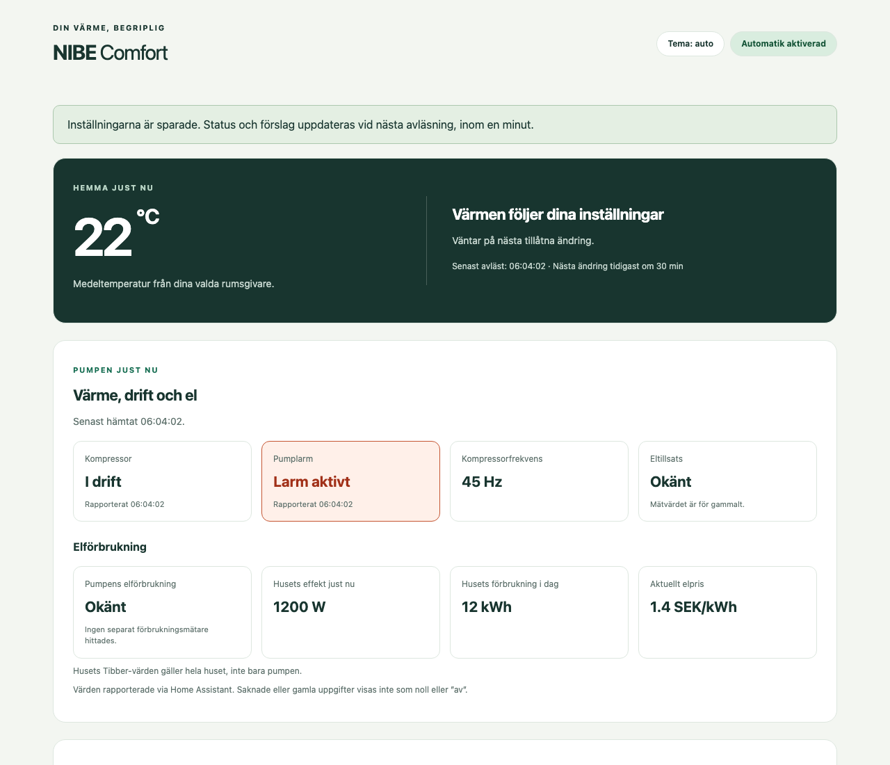 | 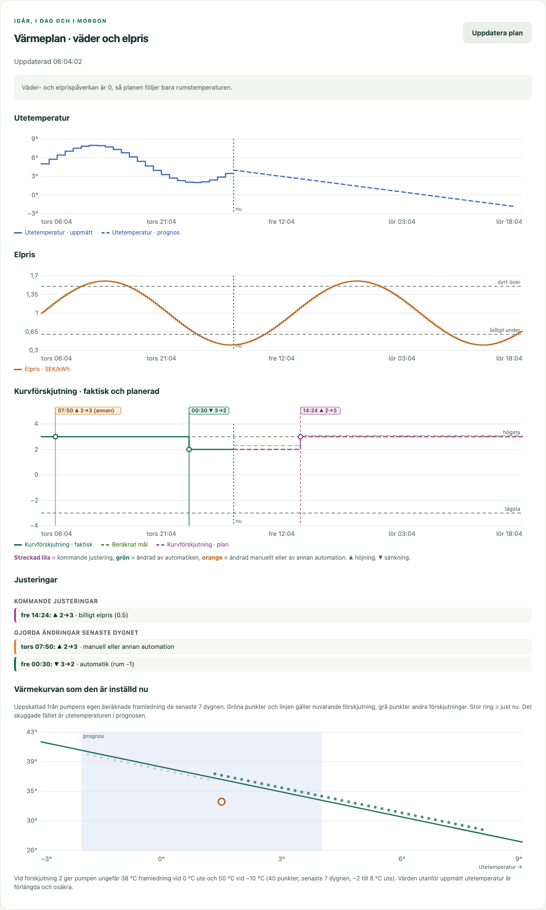 |

| Temperatur per rum | Inställningar | Mobil |
| --- | --- | --- |
| 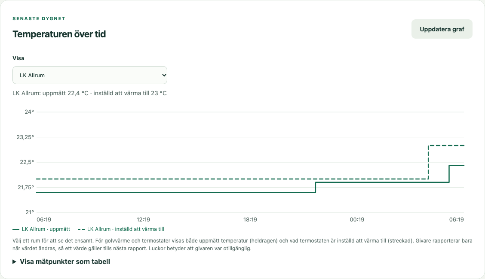 | 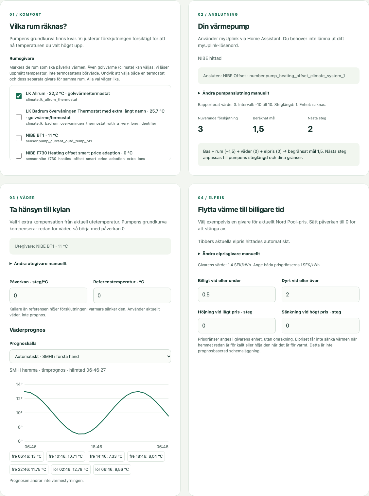 | 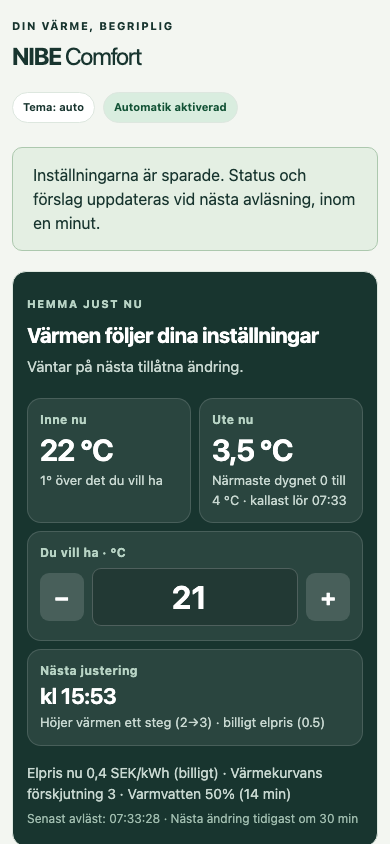 |

| Varmvatten | Varmvatten på mobil |
| --- | --- |
| 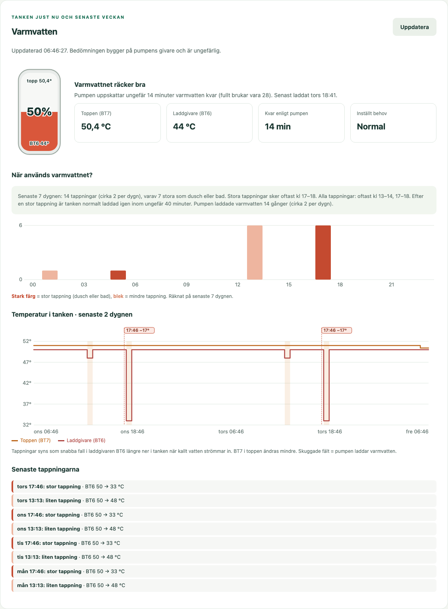 | 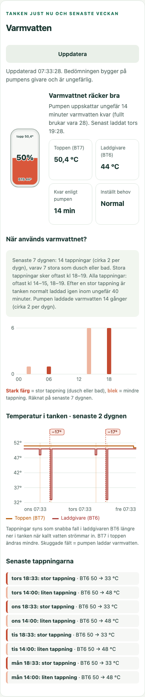 |

| Ditt hus lär sig | Husmodellen på mobil | Husmodellen i mörkt läge |
| --- | --- | --- |
| 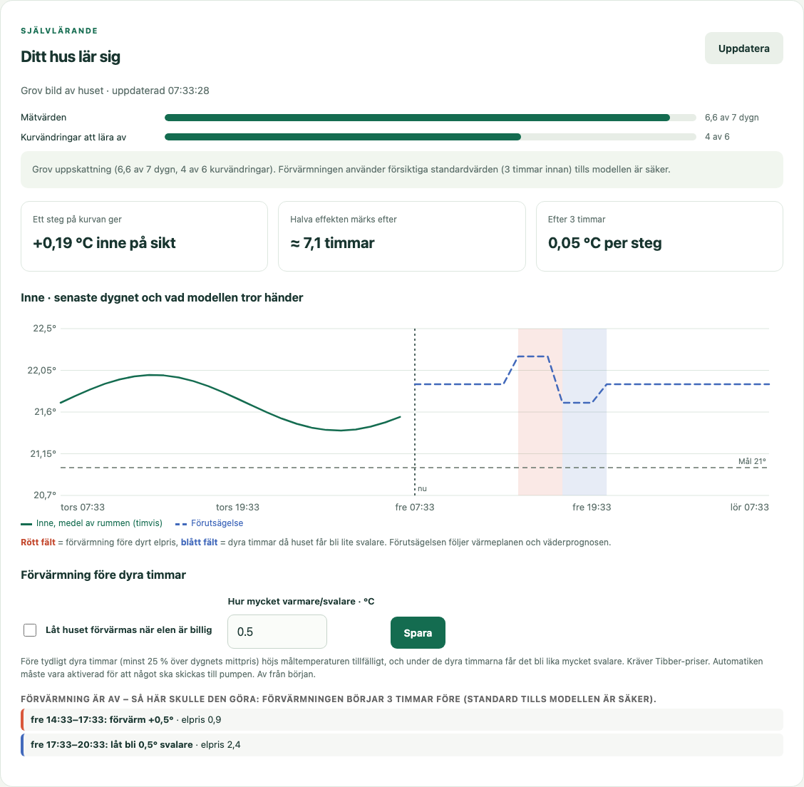 | 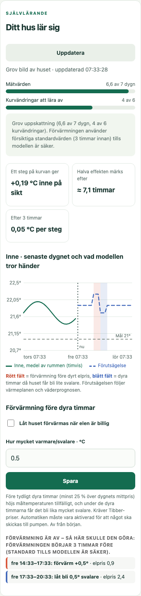 | 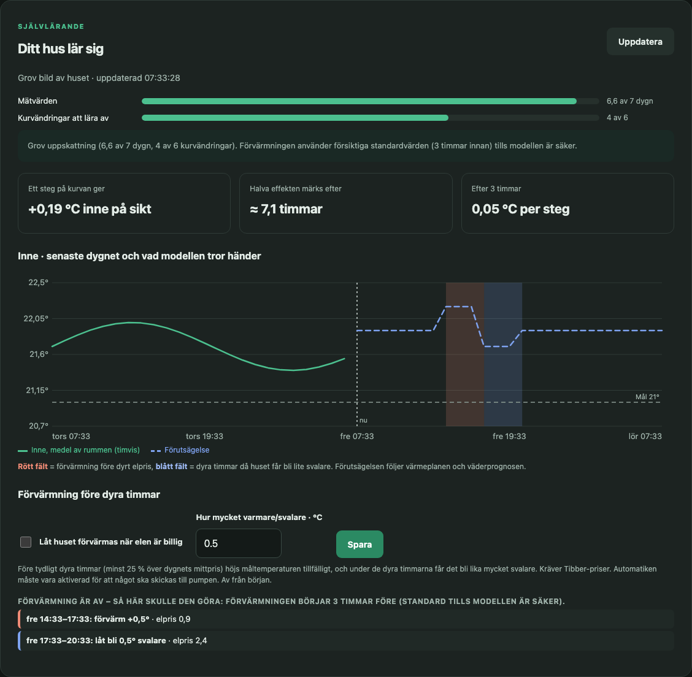 |

| Mörkt läge (följer Home Assistant) | Värmeplan i mörkt läge | Varmvatten i mörkt läge |
| --- | --- | --- |
| 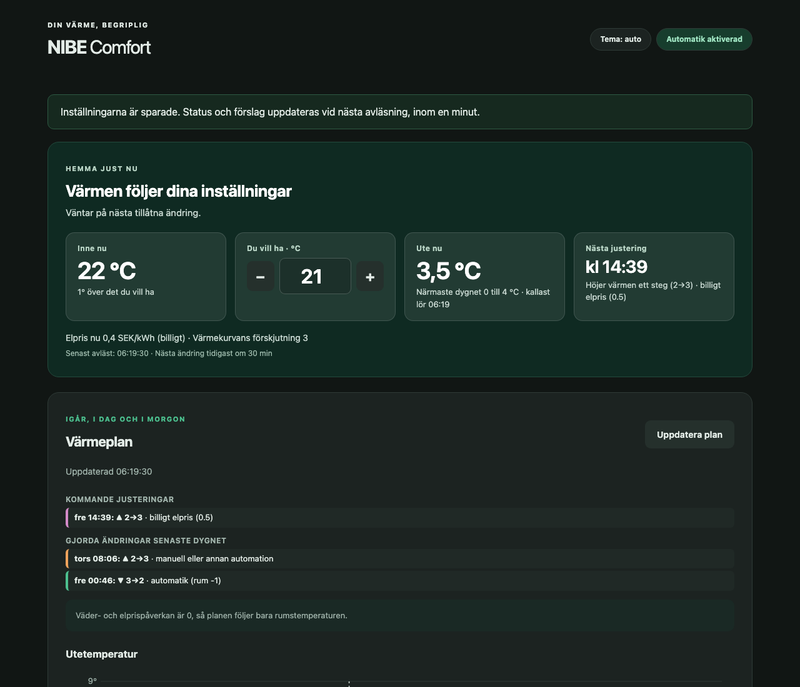 | 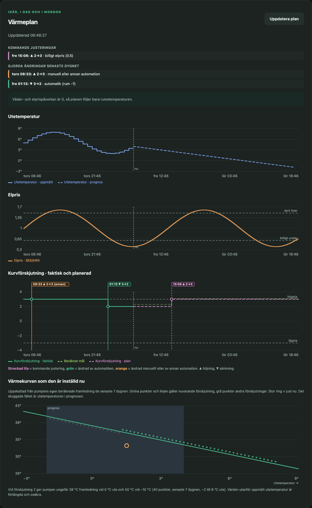 | 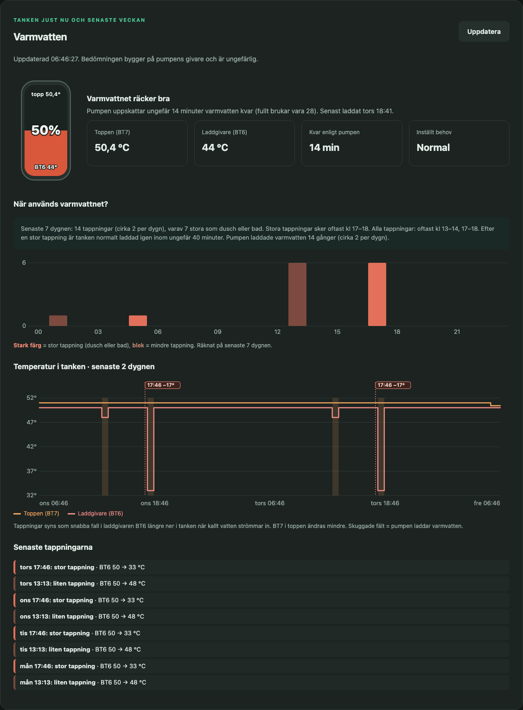 |

Skärmbilderna är tagna med testdata.

## Installation

Kräver Home Assistant OS eller Supervised (tillägg/appar) och
[myUplink-integrationen](https://www.home-assistant.io/integrations/myuplink/).

### Alternativ A – via tilläggsbutiken (rekommenderas, får uppdateringar)

1. **Inställningar → Tillägg → Tilläggsbutik → ⋮ → Repositories**.
2. Lägg till `https://github.com/jesper1982atea/NIBE-F730`.
3. Installera **NIBE Comfort**, starta det och öppna det från sidopanelen.

[](https://my.home-assistant.io/redirect/supervisor_add_addon_repository/?repository_url=https%3A%2F%2Fgithub.com%2Fjesper1982atea%2FNIBE-F730)

### Alternativ B – manuellt med zip-fil (för att testa)

1. Ladda ner `nibe_comfort-<version>.zip` från
   [Releases](https://github.com/jesper1982atea/NIBE-F730/releases/latest)
   och packa upp den. Du får mappen `nibe_comfort`.
2. Kopiera mappen till `/addons` i Home Assistant, till exempel med tillägget
   **Samba share** (`\\homeassistant\addons`), **Studio Code Server** eller SSH.
   Resultatet ska vara `/addons/nibe_comfort/config.yaml`.
3. **Inställningar → Tillägg → Tilläggsbutik → ⋮ → Sök efter uppdateringar**.
4. Installera **NIBE Comfort** under *Lokala tillägg* och starta det.

En manuell installation uppdateras inte automatiskt. Byt ut mappen mot en
nyare zip och tryck på *Uppdatera* på tillägget, eller gå över till alternativ A.

### Första start

1. Öppna webbgränssnittet. Tillägget försöker hitta myUplinks kurvförskjutning
   för klimatsystem 1 och samma pumps utegivare BT1 automatiskt.
   Välj dina rumsgivare själv och spara inställningarna.
2. Kontrollera enhet, tillåtet intervall och steglängd i Home Assistant.
   Anpassa säkerhetsgränserna till din anläggning.
3. Börja med övervakning. Kontrollera anslutningen och förslagen innan du
   aktiverar automatiken. Manuell anslutning finns under utfällbara inställningar.
4. Öppna **Testa styrningen** och tryck *Starta test* för att se att pumpen
   tar emot en ändring. Förskjutningen ställs tillbaka efter 10 minuter.
5. Vill du framför allt få ett visst rum närmare målet kan du välja 1–2
   **prioriterade rumsgivare** i inställningarna. Deras snitt styr då värmen.
   Startsidan visar också alla valda rums snitt och varje rums temperatur
   och förändring. Förskjutningen påverkar hela huset, även redan varma rum.

Alla NIBE-parametrar exponeras inte som skrivbara entiteter av myUplink.
Kontobehörighet, pumpmodell och integration avgör tillgängligheten. Saknas
en skrivbar kurvförskjutning kan tillägget visa förslag, men inte styra pumpen.
Det skapar inte en egen direktanslutning till NIBE eller kringgår myUplinks
begränsningar. Grundkurva, varmvatten, ventilation och kompressorskydd lämnas
oförändrade.

Se [användarguiden](nibe_comfort/DOCS.md) för reglering, säkerhet och lokalt API.

## Utveckling

Python 3.12 eller senare, inga externa Pythonpaket:

```sh
python3 -m unittest discover -s nibe_comfort/tests -v
node nibe_comfort/tests/test_discovery_ui.cjs
```

Webbläsartest och nya skärmbilder (Playwright):

```sh
cd tools && npm install && npx playwright install chromium
npm run ui           # testar gränssnittet, även mobilbredder 320–412 px
npm run screenshots  # uppdaterar docs/screenshots
```

## Ny release

1. Höj `version` i `nibe_comfort/config.yaml` och skriv i
   `nibe_comfort/CHANGELOG.md`.
2. Skapa och pusha en tagg: `git tag v0.2.7 && git push origin v0.2.7`.
3. GitHub Actions testar, bygger `nibe_comfort-<version>.zip` och skapar en
   release med zip-filen och installationsinstruktioner.

Tillägget är avsett för Home Assistant OS eller Supervised med Supervisor.
Home Assistant Container/Core kan inte installera Supervisor-tillägg.
